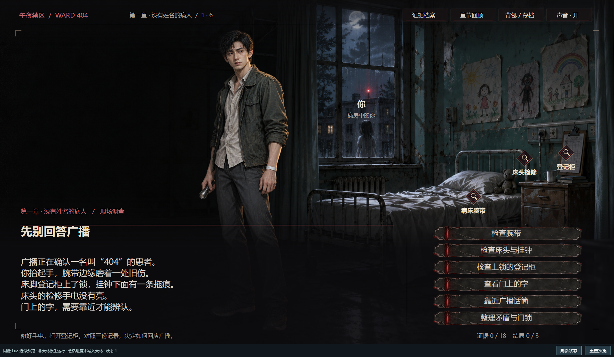
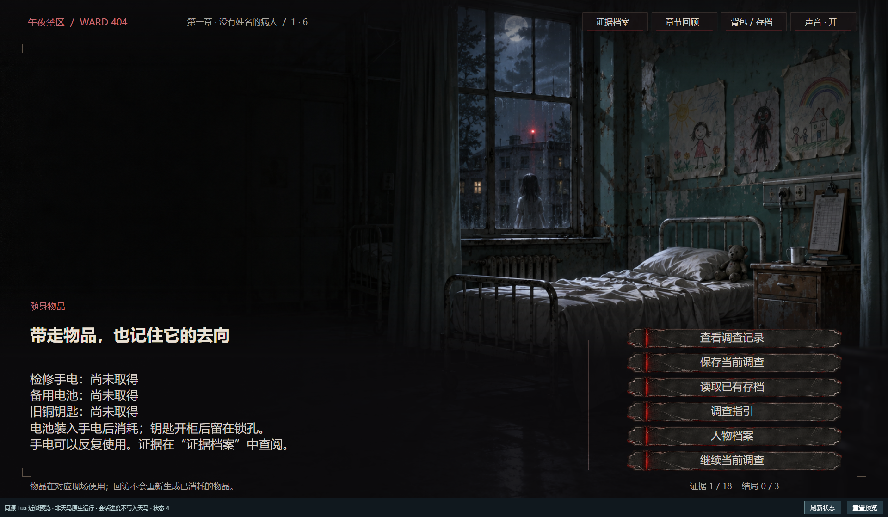

# Pegasus Bridge · 天马工坊编辑器第三方工具

**通过 CLI 和 MCP 读取、编辑、预览和检查天马作品，让重复的创作操作可以由脚本或 AI 助手完成。**

Pegasus Bridge 是面向 **Windows 天马工坊编辑器（PegasusEditor）** 的第三方适配工具，非官方产品。它提供终端命令 `pegasus` 和标准 stdio MCP 服务 `pegasus-mcp`，两种入口共用同一套功能，不修改编辑器安装文件。

**当前版本：0.15.0 · Windows · Python 3.12+ · 53 个 MCP 工具**

[快速开始](#快速开始) · [功能一览](#功能一览) · [案例与截图](#案例与截图) · [测试结果](#测试结果) · [完整文档](#完整文档)



*案例画面：真实游戏脚本在本工具的浏览器 Lua 预览器中运行。此图不是天马编辑器或 Unity 原生试玩截图。*

## 功能一览

| 你要做的事 | 工具能完成什么 | 主要 CLI 命令 |
|---|---|---|
| 查看和导出作品 | 读取作品、场景、剧情、变量、UI、故事线及商品配置 | `game-state`、`read`、`export` |
| 保存命名草稿 | 调用编辑器“保存”使用的备份接口，创建新草稿并读回列表核对 | `save-draft`、`list-drafts` |
| 修改剧情和章节 | 保存 Lua 源码，创建或复用章节/场景，更新故事线节点与连线 | `apply-scene`、`ensure-chapter`、`apply-story-tree` |
| 添加角色立绘 | 上传 PNG，登记角色及表情，配置节点中的位置、大小和显隐，生成 Lua | `character-add`、`character-place`、`build-scene` |
| 添加音频 | 上传 PCM WAV，配置节点音频、音量和循环，生成播放代码 | `upload-audio`、`audio-bind` |
| 修改界面与商城 | 上传图片，更新基本 UI 和商城页面，生成商城布局，编辑已有商品数据 | `upload-image`、`apply-ui`、`build-mall-ui`、`apply-mall-ui`、`apply-goods` |
| 保存前检查 | 检查 Lua 语法、已知不兼容写法及指定素材清单中的引用 | `validate-scene`；`apply-scene` 内置检查 |
| 批量修改多个场景 | 生成差异计划、核对远端版本、逐场景备份保存、失败后核对续跑 | `batch-plan`、`batch-apply`、`batch-resume` |
| 查看和恢复修改 | 查看本工具的剧情备份、比较差异、检查当前版本后恢复 | `history`、`diff`、`restore` |
| 试玩与画面检查 | 在浏览器预览 Lua，执行指定点击路线，输出断言、截图和文字溢出报告 | `preview-start`、`test-route`、`preview-report` |
| 整理工程交付 | 检查清单中的脚本与素材，生成带 SHA256 清单的 ZIP | `project-check`、`project-pack` |
| 查看编辑器和玩家数据 | 诊断进程与日志、发起打开作品请求、读取本机存档和已接入的玩家状态上报 | `status`、`open-game`、`read-archive`、`player-state`、`inventory` |

以上业务功能也通过 MCP 提供。例如，CLI 的 `character-place` 对应 `pegasus_character_place`，`preview-report` 对应 `pegasus_preview_report`。完整参数和清单格式见 [创作工作流](docs/workflows.md)，其他读写操作见 [操作参考](docs/reference.md)。

**角色接入流程：** 准备 PNG → 上传并登记表情 → 配置剧情节点 → 生成 Lua → 预览检查 → 保存。图片和配音的生成由外部工具完成；本工具负责接入已有文件。节点生成需要在源脚本中设置明确的钩子，不会自动理解任意游戏的剧情结构。

## 快速开始

### 1. 安装并检查

先安装 [uv](https://docs.astral.sh/uv/getting-started/installation/) 和 Git，在 PowerShell 中执行：

```powershell
git clone https://github.com/15973081/pegasus-bridge.git
cd pegasus-bridge
uv tool install --python 3.12 ".[preview,qa]"
pegasus doctor-mcp
```

安装到独立用户环境，无需管理员权限。`doctor-mcp` 会实际启动 MCP 子进程，检查初始化、工具发现和状态调用；0.15.0 应返回 `tool_count: 53`。如果命令未加入 PATH，运行 `uv tool dir --bin` 查看命令目录。

也支持本地 wheel / Windows ZIP 安装，详见 [安装与升级](docs/install.md)。目前不通过 PyPI 或插件市场分发。

### 2. 先运行一个本地示例

在刚克隆的仓库目录执行，无需登录天马：

```powershell
pegasus preview-start examples/workflows/preview.json
```

打开返回的 `url`，点击“继续 / 返回”，可在“调查开始”和“调查完成”之间切换。返回结果也包含 `session_id`，可供 `preview-state`、`preview-click`、`preview-reset` 和 `preview-stop` 操作。

### 3. 接入 MCP 客户端

```powershell
pegasus mcp-config --client json
```

将输出的配置加入支持 `mcpServers` JSON 的客户端。服务使用 **stdio**，由客户端启动；浏览器预览的 HTTP 地址不能作为 MCP 服务地址。其他配置格式与接入步骤见 [MCP 安装文档](docs/install.md)。升级后重新连接该服务，客户端才会加载新工具。

接入并配置天马会话后，可以让 AI 助手执行这样的任务：

> 读取我的作品章节，把准备好的角色 PNG 登记为角色表情，在指定节点配置立绘；先生成 Lua 并检查，再生成修改计划给我查看。

### 4. 连接自己的天马作品

在线读取和保存需要有效登录；编辑操作还需要本机已有对应作品的编辑会话。先在天马客户端登录并打开作品，再为 CLI 或 MCP 服务配置认证。

```powershell
# 显式允许 CLI 使用本机天马日志中已有的登录会话
$env:PEGASUS_ALLOW_LOG_AUTH = '1'
pegasus recent-games
# 将 123456 替换为自己的作品 ID
pegasus game-state 123456
```

MCP 服务的环境变量要在客户端中单独配置。默认不会从日志自动提取认证。窗口关闭后，只要认证和所需编辑会话仍有效，接口读写可以继续；这不代表能在关闭窗口时执行原生试玩。详细认证方式见 [操作参考](docs/reference.md#在线操作的认证配置)。

## 原生保存与命名草稿

可以像编辑器的“保存”窗口一样，为后台当前内容创建命名备份，再从编辑器“打开”列表找到它：

```powershell
pegasus list-drafts 123456
pegasus save-draft 123456 "第一章_立绘完成" --checkpoint .\exports\draft-001.json
```

已通过真实 MCP 创建并核对《404号病房》的草稿 **`404病房_角色与调查版_MCP_20261029`**（备份 ID `672294`）。重复调用复用原结果，六章剧情源码保持一致。它保存后台已收到的内容，不强制提交编辑器内存中尚未同步的修改。用法、验证证据与限制见 [原生命名草稿](docs/native-drafts.md)。

## 案例与截图

### 《午夜禁区：404号病房》：角色与调查流程

这个已有游戏用于验证真实脚本的预览、角色显隐和多章节批量核对。本次自动路线为：**进入病房 → 检查腕带 → 返回调查 → 打开背包**。

| 检查点 | 实际结果 |
|---|---|
| 进入病房 | 角色立绘可见，姓名显示“你” |
| 检查腕带 | 页面标题切换为“没有姓名的腕带” |
| 返回调查 | 角色姓名更新为“林默” |
| 打开背包 | 角色立绘隐藏，切换为物品页面 |
| 路线与布局 | 4 份状态快照、4 张截图；断言通过，未检出文字溢出 |
| 六章批量核对 | 真实 MCP 完成计划、执行和续跑核对；目标与云端相同，云端写入 0 次 |



*同一脚本路线中的背包页面。画面中出现“保存/读取存档”按钮，不表示本次已验收原生存读档功能。*

完整截图、路线 JSON、检查报告及验证边界见 [案例与测试记录](docs/cases.md)。仓库提供案例截图和测试证据，不包含该游戏的完整剧本及原始素材包；可直接复现的最小示例位于 [`examples/workflows`](examples/workflows)。

## 测试结果

**0.13.0，本机验证日期：2026-10-29。**

| 验证项目 | 结果 |
|---|---|
| 自动化测试 | 共 188 项：186 项通过，2 项因 Windows 符号链接权限跳过 |
| MCP 协议测试 | 实际启动 stdio 服务，发现 50 个工具，正常调用和错误调用检查通过 |
| 新工作流 MCP 测试 | 配置读写、Lua 检查/生成、路线测试、工程检查/打包通过；无云端写入 |
| 仓库内最小示例 | “开始 → 完成 → 开始”3 份快照，截图与布局检查通过 |
| 原生命名草稿 | 真实 MCP 新建备份并读回，重复调用复用；六章源码一致 |
| 真实游戏案例 | 上述 4 状态路线通过，6 章同内容批量核对通过 |

复现测试与画面报告：

```powershell
uv sync --locked --extra preview --extra qa
uv run python -m unittest discover -s tests
uv run python tests/smoke_mcp.py
uv run python tests/smoke_workflows.py
uv run pegasus preview-report examples/workflows/preview.json examples/workflows/route.json artifacts/my-first-report
```

画面报告使用 Playwright Chromium 或本机 Edge；若两者都不可用，执行 `uv run python -m playwright install chromium`。输出目录必须是新目录，重复运行请换名字。当前草稿功能证据见 [原生命名草稿](docs/native-drafts.md)，0.12.0 画面案例与历史测试输出见 [测试证据](docs/cases.md#验证记录)。

## 使用边界

- **第三方适配。** 依赖已观测的天马接口和本地数据格式，上游更新可能影响兼容性；不包含编辑器本体或登录凭据。
- **预览范围。** Lua 浏览器预览用于逻辑与布局检查，不能代替 Unity 原生试玩、动画、实际音频时序、支付或原生存读档验收。
- **保存范围。** 写入前检查和备份、写后读回核对；后台没有跨场景事务或原子版本锁，仍应避免编辑器与工具同时保存同一内容。
- **未实现或未完成实机验证。** 不支持发布作品、控制原生试玩或写云存档；已有商品修改仅做模拟接口测试，新增音频上传尚未完成本轮真实上传验收。玩家状态读取需要作品主动接入上报。
- **交付范围。** 工程 ZIP 用于整理与校验文件，不提供跨作品一键导入，也不迁移素材权益。

## 完整文档

| 文档 | 内容 |
|---|---|
| [安装与接入](docs/install.md) | 源码、Windows ZIP、MCP 配置、自检与升级 |
| [原生命名草稿](docs/native-drafts.md) | 编辑器保存窗口对应的命名备份，创建与列举 |
| [创作工作流](docs/workflows.md) | 角色、音频、Lua 检查、批量任务、恢复与工程打包 |
| [浏览器预览](docs/preview.md) | 预览清单、交互接口、支持范围和会话管理 |
| [操作参考](docs/reference.md) | 认证、作品读写、UI、章节、故事线、商城、存档与观察数据 |
| [案例与测试记录](docs/cases.md) | 真实截图、复现命令、JSON 报告和测试输出 |
| [历史验证记录](docs/validation-history.md) | 各版本的测试与原生接口验证记录 |

## 横竖版工程（0.15）

`pegasus_get_orientation` 返回两处后台方向、逻辑画布尺寸和创建能力。
新增 `pegasus_create_orientation_variant`，按源作品基本信息创建横版或竖版空白工程，
固定使用天马 `mode=8`，保存检查点并核验初始化结果；原作不变，内容迁移单独报告为未开始。
旧 `pegasus_set_orientation` 对方向变更返回 `unsupported`，停止发送已实测无效的修改请求；
旧检查点仍可读回核对。新建竖版不等于既有作品已转换或 UI 已适配。
参数与验证边界见 [横竖版工程](docs/orientation.md)。
