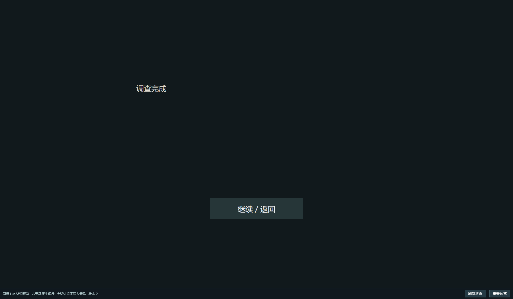
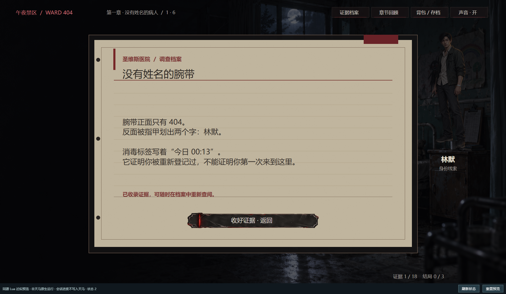
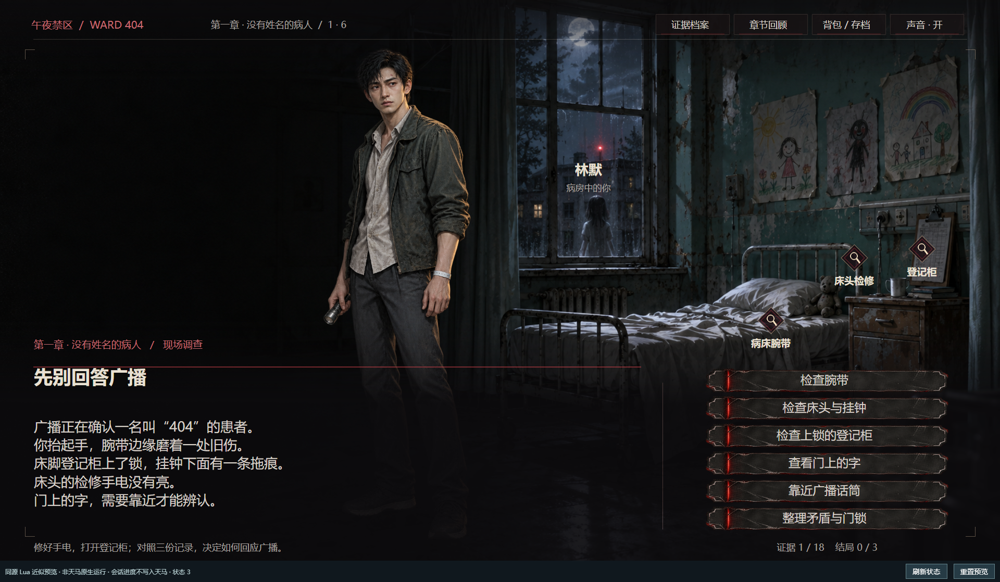

# 案例与测试记录

[返回项目首页](../README.md) · [创作工作流](workflows.md) · [浏览器预览说明](preview.md)

版本 **0.12.0**，记录日期 **2026-10-29**。本页区分可从仓库直接复现的最小示例、已有游戏的预览证据和在线接口核对。所有游戏截图均由 `preview-report` 使用浏览器渲染并截取，未对画面内容进行后期修改；不作为 Unity 原生运行验收。

## 案例一：从仓库直接复现

这个示例只包含 Lua 文本和按钮，不需要登录、游戏账号或外部素材。适合首次检查 CLI、预览器和自动路线是否可用。

| 文件 | 用途 |
|---|---|
| [source.lua](../examples/workflows/source.lua) | 两个节点、具名回调和显式角色接入钩子 |
| [preview.json](../examples/workflows/preview.json) | 预览入口和初始变量 |
| [route.json](../examples/workflows/route.json) | 两次点击及文本断言 |
| [project-manifest.json](../examples/workflows/project-manifest.json) | 本地工程检查与打包清单；其中 ID 为占位值 |

在仓库根目录执行：

```powershell
uv sync --locked --extra preview --extra qa
uv run pegasus validate-scene examples/workflows/source.lua
uv run pegasus test-route examples/workflows/preview.json examples/workflows/route.json artifacts/example-route-001
uv run pegasus preview-report examples/workflows/preview.json examples/workflows/route.json artifacts/example-visual-001
uv run pegasus project-check examples/workflows/project-manifest.json
uv run pegasus project-pack examples/workflows/project-manifest.json artifacts/example-project-001.zip
```

每次使用新的输出路径。画面报告需要 Playwright Chromium 或本机 Edge；缺少时运行 `uv run python -m playwright install chromium`。上述操作均在本地完成。

| 状态 | 操作 | 断言结果 | 实际截图 |
|---|---|---|---|
| 0 | 初始加载 | 标题为“调查开始” | [查看](cases/example/screen-000.png) |
| 1 | 点击 `next` | 标题为“调查完成” | [查看](cases/example/screen-001.png) |
| 2 | 再次点击 `next` | 标题回到“调查开始” | [查看](cases/example/screen-002.png) |



本轮重新执行得到 3 份快照，所有断言通过，3 张截图均未检出文字溢出。查看 [路线报告](cases/example/route-report.json) 和 [画面报告](cases/example/visual-report.json)。这验证了真实 Lua 回调执行与状态切换，不代表复杂游戏的所有分支均能自动覆盖。

对应 MCP 工具为 `pegasus_validate_scene`、`pegasus_test_route`、`pegasus_preview_report`、`pegasus_project_check` 和 `pegasus_project_pack`。端到端调用见 [MCP 工作流测试脚本](../tests/smoke_workflows.py)。

## 案例二：《午夜禁区：404号病房》

该已有作品用于检验角色立绘、调查选项、背包页面和六章批量核对。这里收录本机实测截图、路线与报告；作品完整剧本、原始素材包及登录会话不随仓库提供，因此仅克隆仓库无法完整运行此游戏。需要无额外素材的示例时，请使用案例一。

### 一条真实脚本路线

[路线定义](cases/ward404/route.json) 共 3 次点击，加上初始状态，得到 4 份快照。

| 步骤 | 触发操作 | 自动检查 | 结果 |
|---|---|---|---|
| 0 | 初始加载 | `w404_portrait_1` 可见，角色文字为“你” | 通过 |
| 1 | 点击“检查腕带” | `w404_title` 为“没有姓名的腕带” | 通过 |
| 2 | 返回调查 | `w404_portrait_caption_1` 为“林默” | 通过 |
| 3 | 点击“背包 / 存档” | `w404_portrait_1` 隐藏 | 通过 |

**进入病房：立绘、调查热点、文本和选项同屏显示。**


**检查腕带：选择进入对应调查节点。**



**返回调查：角色姓名变为林默。**



**打开背包：人物立绘隐藏，页面显示物品与调查操作。**


[路线报告](cases/ward404/route-report.json) 记录 `passed: true` 和 `snapshots: 4`；[画面报告](cases/ward404/visual-report.json) 中 4 个状态的 `text_overflow` 均为空。报告同时明确 `native_runtime_verified: false`。

本路线没有执行原生存档、支付、全剧情分支或真实音频时序验收。画面上的按钮是作品 UI 的一部分，仅凭按钮显示不能认定背后的原生能力已经验证。该游戏原有角色脚本的预览结果，也不能单独证明新增角色上传接口的所有路径均已线上验证。

### 六章批量计划与续跑核对

使用真实 stdio MCP 读取 6 个场景，将当前云端源码作为目标内容，调用 `batch-plan`、`batch-apply` 和 `batch-resume`。执行和续跑均判断内容已一致并跳过保存。

```json
{
  "scenes": 6,
  "live_mcp_plan": true,
  "no_change_apply": true,
  "no_change_resume": true,
  "cloud_writes": 0
}
```

完整记录：[batch-verification.json](cases/ward404/batch-verification.json)。这验证了线上读取、计划生成和同内容跳过；保存成功但响应丢失、版本冲突、备份恢复等异常路径由自动化测试验证，不将无修改核对描述为线上破坏性测试。

## 验证记录

本轮重新运行自动化测试、两个 MCP 集成脚本和案例一的画面报告；案例二保留此前同版本、同日取得的实测证据。

| 项目 | 结果 | 可检查的证据 |
|---|---|---|
| 自动化测试 | 172 项，170 项通过，2 项因符号链接权限跳过 | [原始输出](cases/unit-tests.txt) |
| stdio MCP 协议 | 初始化、48 工具发现、正常与错误调用通过 | [原始输出](cases/mcp-smoke.txt) · [脚本](../tests/smoke_mcp.py) |
| 新工作流 MCP | 配置初始化/读取、Lua 检查/生成、路线、工程检查/打包通过，无云端写入 | [原始输出](cases/workflows-smoke.txt) · [脚本](../tests/smoke_workflows.py) |
| 最小示例画面 | 3 张截图、0 处检出的文字溢出 | [画面报告](cases/example/visual-report.json) |
| 真实游戏画面 | 4 张截图、0 处检出的文字溢出 | [画面报告](cases/ward404/visual-report.json) |
| 六章同内容核对 | 计划、执行、续跑通过，云端写入 0 次 | [结果](cases/ward404/batch-verification.json) |

```powershell
uv run python -m unittest discover -s tests
uv run python tests/smoke_mcp.py
uv run python tests/smoke_workflows.py
```

测试覆盖角色配置冲突、PNG 预检、生成的 Lua 显隐/音频逻辑、保存前校验、批量版本冲突与续跑、备份恢复、WAV 检查及上传结果不确定时的重复注册保护、路径限制、ZIP 一致性等。网络写入异常使用模拟接口；新增 WAV 上传没有在本轮向真实作品上传音频，已有商品修改仍待线上验收。

截图保留原始 PNG。归档画面报告仅移除了本机绝对路径字段 `report_path`，其余检查结果保留；原始测试输出不含登录凭据。历史版本验证见 [历史验证记录](validation-history.md)。
